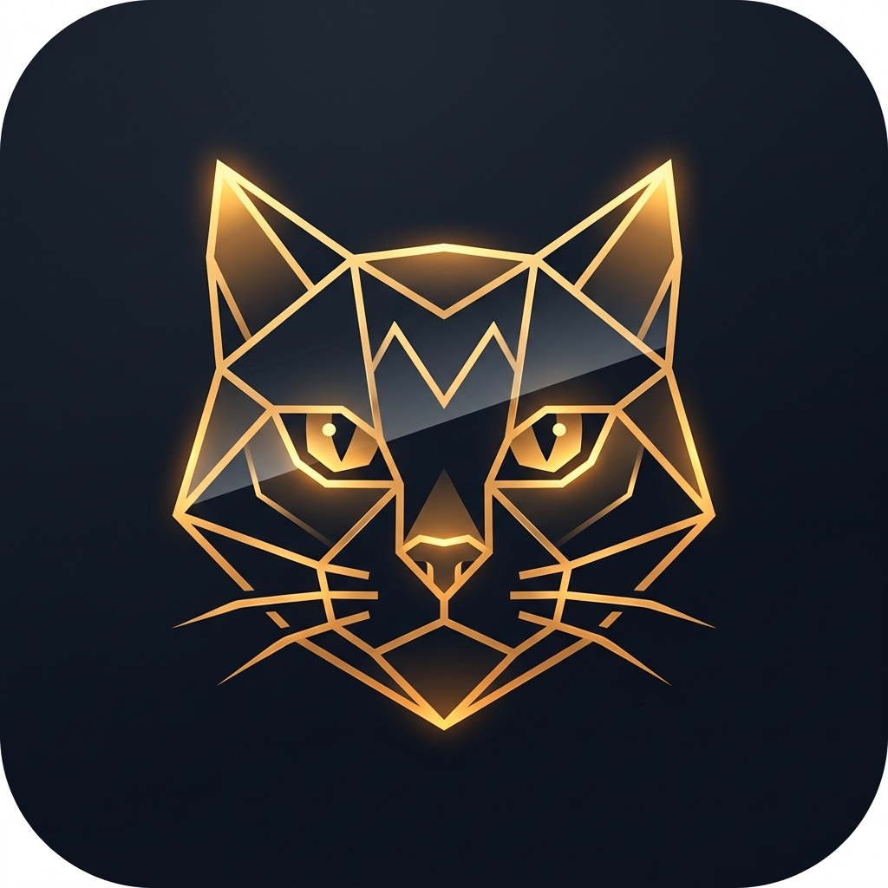

# 🐱 catmirror — Real-Time Screen Mirroring & Remote Touch Control

<p align="center">
  
</p>

<p align="center">
  <b>Transmisión de pantalla en tiempo real y control táctil remoto interactivo entre dispositivos Android a través de Wi-Fi local o cable USB.</b>
</p>

<p align="center">
  
  
  
  
  
</p>

---

## 📌 ¿De qué trata catmirror?

**catmirror** es una aplicación diseñada para conectar dos dispositivos Android (teléfonos o tablets) de forma directa punto a punto. Permite que un **dispositivo emisor** transmita su pantalla en tiempo real a un **dispositivo receptor**, permitiendo que este último no solo observe la pantalla, sino que **pueda interactuar y hacer tap, scroll y usar gestos directamente sobre las aplicaciones del emisor**.

Todo el proceso ocurre de manera **local** (sin servidores en la nube intermediarios, garantizando privacidad total y latencia ultra-baja).

---

## 🚀 Características Principales

* ⚡ **Transmisión en Tiempo Real de Baja Latencia:** Optimizado mediante sockets TCP directos y compresión dinámica de fotogramas, logrando latencias inferiores a 50 ms en redes locales.
* 👆 **Control Táctil Remoto en Todo el Sistema:** Utiliza el API oficial de `AccessibilityService` (`dispatchGesture`) de Android en el emisor para ejecutar toques, arrastres y navegación del sistema (Atrás, Inicio, Apps recientes) enviados desde el receptor.
* 📶 **Conectividad Dual (Wi-Fi Local + Cable USB):**
  * **Wi-Fi:** Detección automática en la misma red mediante balizas UDP (Discovery Beacon).
  * **Cable USB:** Soporte directo a través de Anclaje de red USB (*USB Tethering*) o redirección de puertos ADB (`adb forward tcp:8888 tcp:8888`).
* 🔒 **Emparejamiento Rápido y Seguro:** Código PIN de 6 dígitos autogenerado y código QR dibujado en pantalla para vinculación instantánea.
* 🎮 **Barra de Navegación Remota:** Atajos dedicados para los botones del sistema Android (*Atrás*, *Inicio*, *Multitarea*) y alternancia de escala de pantalla (*Ajustar / Llenar*).
* 🛠️ **Consola de Diagnósticos y Errores Integrada:** Visor de eventos en vivo dentro de la app con botón de un toque para copiar reportes técnicos y facilitar la depuración.

---

## 📥 Descarga del APK

Puedes descargar directamente el instalador `.apk` listo para tus teléfonos:

👉 **[Descargar la última versión de catmirror (APK)](../../releases/latest)**

*(En cada actualización en este repositorio, GitHub Actions compila automáticamente el archivo `catmirror.apk` en la pestaña de [Releases](../../releases)).*

---

## 📱 Compatibilidad

* **Versión mínima:** Android 7.0 Nougat (API 24)
* **Versión recomendada/probada:** Android 11 (One UI 3 / Samsung Galaxy A30s y similares), Android 12, 13, 14, 15 y 16.
* **Marcas soportadas:** Samsung Galaxy, Xiaomi, Google Pixel, Motorola, OnePlus, Realme, etc.

---

## 📖 Guía de Uso Paso a Paso

### 1. Preparación en ambos dispositivos
Instala el archivo `catmirror.apk` en los dos teléfonos.

### 2. Dispositivo Emisor (El teléfono que transmitirá su pantalla)
1. Abre **catmirror** y selecciona **Pantalla Emisor**.
2. **Activar el Control Táctil (Primera vez):**
   * Toca el aviso de accesibilidad que te llevará a los Ajustes de Android.
   * Ve a *Accesibilidad > Servicios instalados > catmirror Servicio de Control Táctil* y actívalo.
3. Presiona **"Iniciar Transmisión de Pantalla"** y acepta el permiso del sistema (*MediaProjection*).
4. Verás en pantalla el **código PIN de 6 dígitos** y la dirección IP local (ej. `192.168.1.45:8888`).

### 3. Dispositivo Receptor (El teléfono que verá y controlará)
1. Abre **catmirror** y selecciona **Pantalla Receptor**.
2. **Vía Wi-Fi:** En la pestaña *Detección Wi-Fi*, espera unos segundos a que aparezca el nombre del teléfono emisor, pulsa **"Conectar"** e introduce el PIN de 6 dígitos.
3. **Vía Cable USB / Manual:** En la pestaña *Cable USB / Manual*, introduce la IP del emisor (o `127.0.0.1` si usas ADB) junto con el PIN y pulsa **"Conectar Ahora"**.
4. ¡Listo! Verás la pantalla en tiempo real y podrás tocarla para interactuar con sus aplicaciones.

---

## 🛠️ Tecnologías Utilizadas

* **Lenguaje:** Kotlin 2.x
* **UI:** Jetpack Compose con Material Design 3
* **Captura de Pantalla:** Android `MediaProjectionManager` + `VirtualDisplay` + `ImageReader`
* **Inyección de Toques:** `AccessibilityService` (`dispatchGesture`, `performGlobalAction`)
* **Red:** TCP Server/Client Sockets + UDP Discovery Beacons + OkHttp
* **Concurrencia:** Kotlin Coroutines & `StateFlow`
* **Servicio en Primer Plano:** `ForegroundService` con canal de notificación permanente

---

## 💻 Compilación desde el Código Fuente

Si deseas clonar el proyecto y compilarlo tú mismo en tu computadora:

```bash
# Clonar el repositorio
git clone https://github.com/brauliofv/catmirror.git
cd catmirror

# Otorgar permisos al wrapper (Linux / macOS)
chmod +x gradlew

# Compilar el APK de depuración
./gradlew assembleDebug

# En Windows:
gradlew.bat assembleDebug
```

El archivo APK compilado se encontrará en:
`app/build/outputs/apk/debug/app-debug.apk`

---

## 🤝 Soporte y Reporte de Errores

Si experimentas problemas de conexión o permisos:
1. En la pantalla principal de **catmirror**, toca el icono de terminal `[ >_ ]` en la tarjeta de red.
2. Presiona **"Copiar"** para obtener el reporte con los detalles técnicos del fallo.
3. Abre un [Issue en GitHub](../../issues) y pega el informe copiado para revisarlo y corregirlo.

---

## 📄 Licencia

Este proyecto está bajo la Licencia [MIT](LICENSE).
